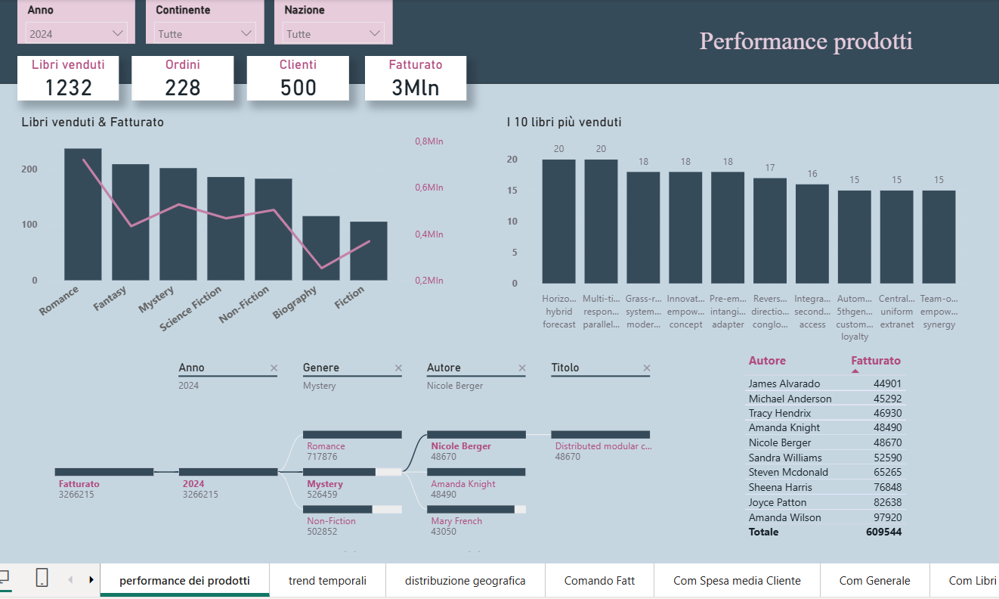

# Online Bookstore: Sales Analysis & Marketing Strategy

## Project Overview

This Capstone Project explores the sales performance of an online bookstore looking to expand its business and identify the most effective marketing strategies.

The goal is to analyze sales data from product, temporal, and geographical perspectives, uncovering insights into customer behavior, top-performing products, and revenue trends to support data-driven business decisions.

## Tools & Technologies

- **Python & Pandas:** Data cleaning.
- **SQL (MySQL):** Data exploration and querying.
- **Power BI:** Interactive dashboard development and data visualization.

## SQL Analysis

The initial analysis focused on three main areas:

- **Product Performance:** Identifying the best-selling genres, top 20 books by revenue, and highest-performing authors.
- **Temporal Trends:** Analyzing revenue by year and month, as well as customer activity across days of the week.
- **Geographical Distribution:** Comparing sales across countries, identifying customer distribution, and exploring geographical differences in revenue.

## Power BI Dashboard

The interactive report is organized into three main pages.

### 1. Product Performance

Analyzes product sales and revenue to identify the bookstore's strongest performers.

Key features:
- KPIs: Books Sold, Orders, Customers, and Revenue.
- Sales and revenue by book genre.
- Top 10 best-selling books.
- Top 10 authors by revenue.
- Interactive treemap for exploring revenue by genre, author, and book title.

### 2. Temporal Trends

Explores revenue patterns over time to support sales planning and marketing decisions.

Key features:
- Revenue breakdown by quarter, month, and day of the week.
- Comparison between current-year revenue and the same period in the previous year.
- Interactive filters to investigate specific periods and customer markets.

### 3. Geographical Distribution

Examines sales performance and customer spending across continents and countries.

Key features:
- Books sold and revenue by continent.
- Average revenue and books sold per customer.
- Map visualization highlighting countries with higher average customer spending.
- Top 10 countries by revenue and books sold.

## Key Insights

The analysis revealed several interesting patterns:

- **Romance** emerged as the leading genre in both books sold and revenue.
- **Asia** recorded the highest sales volume and revenue among the continents analyzed.
- The dashboard enables users to explore differences in sales performance across time periods and geographical markets.
- Identifying countries with higher average customer spending can help inform targeted marketing campaigns and potential expansion strategies.

## Interactive Features

The Power BI report includes interactive filters for year, continent, and country, allowing users to explore the data dynamically and investigate specific market segments.

## Conclusion

This project demonstrates an end-to-end data analysis workflow, from SQL-based data exploration to interactive Power BI reporting.

By combining product performance, temporal trends, and geographical analysis, the project transforms raw sales data into actionable insights that can help an online bookstore evaluate its performance and make more informed marketing and business decisions.
